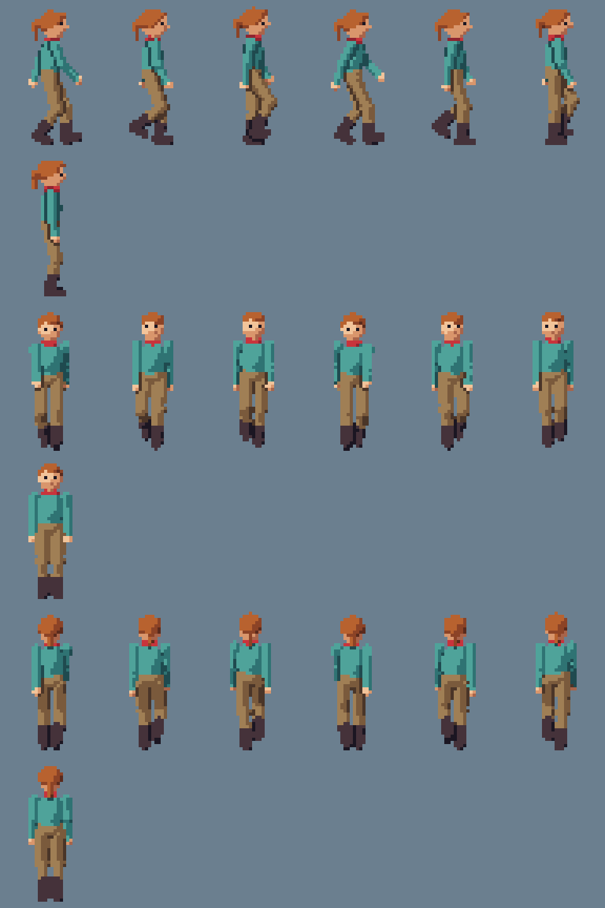
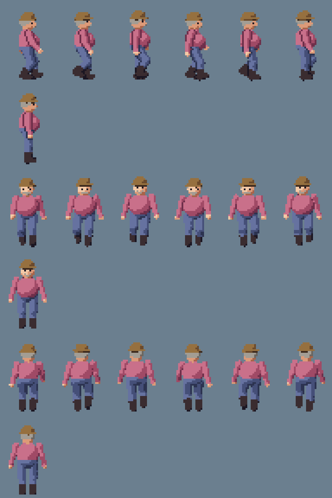
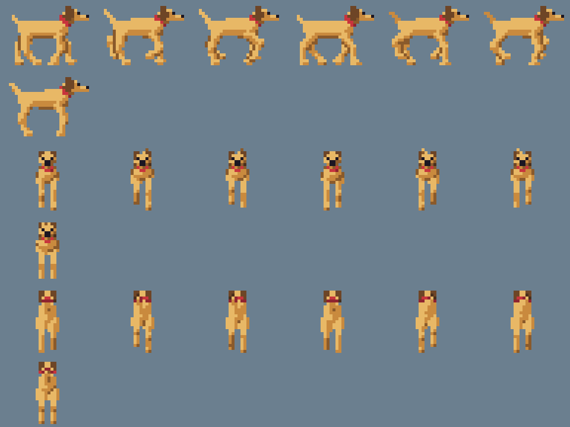

# Pixel-Sprite

Adventure-Figuren im Stil der frühen 90er, vollständig per Code erzeugt: kein Pixel-Artist, kein Blender, keine fremden Assets, keine KI-Bilder. Eine Figur wird als 3D-Skelett mit einfachen Körperformen beschrieben, ihr Gang wird berechnet, und ein kleiner Renderer macht daraus direkt Pixel-Sprites in Zielauflösung.

**Bewegte Vorschau:** https://joergsf4.github.io/Pixel-Sprite/

| Abenteurer | Dicker Mann mit Hut | Hund |
|---|---|---|
|  |  |  |

Die Bilder zeigen je Figur von oben nach unten: Gehen von der Seite (6 Phasen), Stehen, Gehen von vorn, Stehen, Gehen von hinten, Stehen. Fünffach vergrößert.

## Warum

Für ein Grafikadventure braucht die Spielfigur Gehphasen in alle Richtungen, dazu Standbilder. Das sind schnell 40 Einzelbilder je Figur, die untereinander stimmig sein müssen. Von Hand gezeichnet ist das die Arbeit eines Pixel-Artists. Hier entsteht alles aus einer Beschreibung der Figur: Wer die Hose umfärbt, einen Hut aufsetzt oder die Schrittlänge ändert, bekommt alle Bilder in einer Sekunde neu und in sich stimmig.

## Benutzung

Voraussetzung ist Node.js ab Version 22. Es gibt keine Abhängigkeiten, also auch kein `npm install`.

```sh
node cli.js build   # erzeugt Sprite-Sheets und Vorschau
node cli.js check   # prüft Gang und Sprite-Sheets
```

`build` schreibt je Figur nach `out/`:

| Datei | Inhalt |
|---|---|
| `<name>.png` | Sprite-Sheet in Originalgröße, durchsichtiger Hintergrund |
| `<name>.json` | Lage der Einzelbilder, Ankerpunkt, Schrittweite |
| `<name>_preview.png` | Übersicht, fünffach vergrößert |
| `preview.html` | bewegte Vorschau aller Figuren, läuft per Doppelklick ohne Server |

Zusätzlich landet eine Kopie der Vorschau in `docs/`, von dort wird sie über GitHub Pages ausgeliefert.

## Wie es funktioniert

### 1. Figur beschreiben (`character.js`)

Jede Figur ist ein Datensatz: Maße des Skeletts (Beinlänge, Schulterbreite, Kopfgröße …), Materialien mit je drei Farbtönen (dunkel, mittel, hell), Werte für den Gang und optionale Zusätze wie Hut, Bauch, Schnurrbart oder Pferdeschwanz. Alle Längen sind Pixel der Zielauflösung; der Abenteurer ist rund 44 Pixel hoch.

Achsen: Y zeigt nach oben, Z in Blickrichtung der Figur, X zu ihrer linken Seite.

### 2. Skelett und Körperformen (`src/rig.js`)

Aus einer Pose werden die Gelenkpunkte berechnet. Knie und Ellbogen ergeben sich über inverse Kinematik mit zwei Knochen: Hüfte und Fußpunkt sind gegeben, das Knie folgt aus den Knochenlängen. An den Knochen hängen einfache Grundformen: Kapseln mit zwei Radien für Arme, Beine und Hals, Ellipsoide für Kopf, Rumpf, Becken, Hut und Hände. Jede Form trägt ein Material und gehört zu einem Körperteil.

Es gibt zwei Baupläne: Zweibeiner (Abenteurer und dicker Mann teilen sich dasselbe Skelett mit anderen Maßen) und Vierbeiner (Hund mit vier Beinen, Schnauze, Schlappohren und Schwanz).

### 3. Bewegung berechnen (`src/anim.js`)

Keine Pose ist von Hand gesetzt. Der Gang ist eine Funktion der Phase von 0 bis 1:

- **Füße:** Solange ein Fuß am Boden ist, wandert er gleichmäßig nach hinten. In der Luft schwingt er im Bogen nach vorn. Beim Aufsetzen zeigt die Fußspitze nach oben, beim Abstoßen hebt sich die Ferse, während die Zehen am Boden bleiben.
- **Becken:** wippt zweimal je Zyklus auf und ab, pendelt zum Standbein und dreht sich mit dem vorderen Bein mit.
- **Oberkörper und Arme:** Der Brustkorb dreht gegen das Becken, die Arme schwingen gegenläufig zu den Beinen, der Ellbogen beugt sich beim Vorschwingen.
- **Hund:** Trab, also diagonale Beinpaare gemeinsam. Rumpf und Kopf wippen, der Schwanz wedelt.

Weil der Standfuß sich je Phase um genau die Strecke nach hinten bewegt, die das Spiel die Figur nach vorn schiebt, rutschen die Füße nicht. Diese Strecke steht als `stepPx` in der JSON-Datei.

### 4. Rendern in Zielauflösung (`src/render.js`)

Die Körperformen sind als Abstandsfunktionen beschrieben: Für jeden Punkt im Raum lässt sich ausrechnen, wie weit die Figur entfernt ist. Formen desselben Körperteils gehen weich ineinander über, verschiedene Körperteile bleiben getrennt.

Für jeden Pixel der Zelle laufen neun parallele Sehstrahlen von der Kamera in die Szene (Parallelprojektion, leicht von oben). Wo ein Strahl die Figur trifft, werden Material, Körperteil, Tiefe und die Richtung der Oberfläche bestimmt. Aus der Oberflächenrichtung und einem festen Licht von links oben ergibt sich eine von drei Helligkeitsstufen. Unter den neun Strahlen entscheidet die Mehrheit; trifft weniger als die Hälfte, bleibt der Pixel durchsichtig.

Gerendert wird direkt in der endgültigen Größe und nicht groß mit anschließendem Verkleinern. Deshalb gibt es keine weichgezeichneten Kanten und keine Zwischenfarben, sondern nur die Farbtöne der Materialien.

### 5. Pixel-Regeln (`src/pixel.js`)

Nach dem Rendern greifen ein paar Regeln, die ein Pixel-Artist von Hand anwenden würde:

- **Trennkanten:** Liegt ein anderes Körperteil deutlich vor einem Pixel, wird dieser dunkel. So hebt sich der Arm vom Rumpf ab, obwohl beide dieselbe Jackenfarbe haben.
- **Augen:** Ein Gesicht ist hier etwa fünf Pixel breit. Die Augen werden deshalb nicht gerendert, sondern als einzelne dunkle Pixel an die Stelle gesetzt, an der der Augenpunkt des 3D-Kopfes auf dem Bild landet, und nur, wenn er zur Kamera zeigt und nicht verdeckt ist.
- **Aufräumen:** Einzelne Pixel ohne Nachbarn werden entfernt.
- **Palette:** Jeder Pixel bekommt einen festen Paletteneintrag. Jede Figur kommt mit höchstens 16 Farben aus.

### 6. Sprite-Sheet (`src/sheet.js`, `src/png.js`)

Die Einzelbilder werden zeilenweise zusammengesetzt: je Ansicht eine Zeile Gehen und eine Zeile Stehen. Das PNG schreibt ein eigener kleiner Encoder auf Basis von `node:zlib`.

## Format der JSON-Datei

```json
{
  "image": "hero.png",
  "cell": { "w": 32, "h": 48 },
  "anchor": { "x": 16, "y": 46 },
  "stepPx": 3,
  "animations": {
    "walk_side": { "fps": 10, "frames": [{ "x": 0, "y": 0, "w": 32, "h": 48 }] }
  }
}
```

- `anchor` ist der Punkt der Zelle, der auf der Bodenposition der Figur liegt (zwischen den Füßen).
- `stepPx` ist der Weg in Pixeln, den das Spiel die Figur je Gehphase bewegen muss, damit die Füße nicht rutschen.
- Animationen heißen `walk_side`, `walk_front`, `walk_back`, `stand_side`, `stand_front`, `stand_back`. `side` blickt nach rechts; für links wird das Bild gespiegelt.

## Eigene Figur anlegen

In `character.js` einen Datensatz kopieren, `name` ändern und in die Liste `characters` am Dateiende eintragen. Nützliche Stellschrauben:

| Bereich | Wirkung |
|---|---|
| `materials` | Farben, je Material dunkel, mittel, hell |
| `body` | Proportionen: Beinlängen, Rumpf- und Kopfgröße, Gliederdicke |
| `extras` | zusätzliche Ellipsoide an Kopf, Brust oder Becken (Hut, Bauch, Bart) |
| `ponytail`, `tuft` | Frisur |
| `gait.stride`, `gait.frames` | Schrittlänge und Zahl der Phasen; `stride / frames` muss ganzzahlig sein |
| `gait.bob`, `sway`, `armSwing`, `lean` | Charakter des Gangs: wippend, schwankend, steif, vorgebeugt |

Danach `node cli.js build` und `node cli.js check` ausführen.

## Was geprüft wird

`node cli.js check` meldet für jede Figur:

- ob der Standfuß je Phase genau um `stepPx` nach hinten wandert (kein Rutschen),
- ob der Gehzyklus nahtlos schließt und kein Bein überstreckt ist (Zweibeiner),
- ob höchstens 16 Farben verwendet werden,
- ob die Füße in jedem Bild auf derselben Grundlinie stehen und kein Bild den Zellenrand berührt.

## Stand und Grenzen

- Vorhanden sind Gehen und Stehen in drei Ansichten. Sprechen, Greifen und eine Vorschau mit Reglern fehlen noch.
- Der Gang ist berechnet und in sich stimmig, aber keine Bewegungsaufnahme eines echten Menschen. Von der Seite wirkt er noch etwas geduckt.
- Der Hund überzeugt von der Seite; von vorn und hinten ist er sehr schmal.
- Der Pferdeschwanz ist starr und schwingt beim Gehen nicht mit.
- Die bewegte Vorschau ist bisher nur auf Syntax geprüft und von Hand im Browser angesehen, es gibt keinen automatischen Test dafür.
